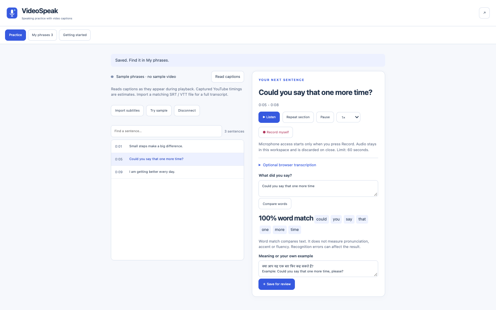
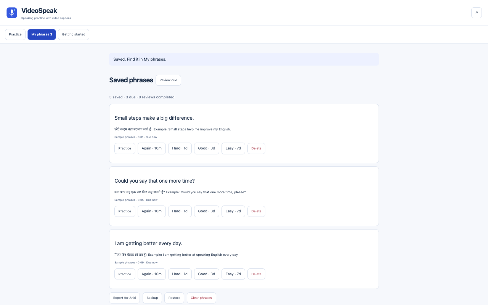

# VideoSpeak

Practice English speaking with video captions. Repeat sentences, record your voice, compare words and save phrases with notes for review.

[Product guide](https://thexerer.github.io/videospeak-privacy/product.html) · [Privacy policy](https://thexerer.github.io/videospeak-privacy/) · [Support and feature requests](https://github.com/thexerer/videospeak-privacy/issues)

**[Install VideoSpeak from the Chrome Web Store](https://chromewebstore.google.com/detail/videospeak/hmjagehcbajijdnlnigphmngpihonkgn)**

## Turn video captions into speaking practice.

Choose one sentence from a video, listen to it, say it aloud and record yourself. Keep useful phrases with your own translation or example, then return to them for review.

### Practice with captions

Read visible YouTube captions or active HTML5 subtitle tracks. Import matching SRT or WebVTT subtitles for a full timed transcript.

### Listen, repeat and record

Replay or loop a section, adjust playback speed and record up to 60 seconds. Listen to your recording or download it.

### Compare words

Type what you said or choose optional browser transcription. See matching, missing and extra words. This compares text, not pronunciation or fluency.

### Build a phrase library

Save up to 500 phrases with your notes. Choose fixed review intervals and export four fields for Anki or a JSON backup.

## Screenshots

## Getting started

1. Open a video and enable captions. Click the VideoSpeak toolbar icon.
2. Let a few sentences play, then press Read captions. You can also import matching SRT/VTT subtitles.
3. Choose a sentence. Press Listen or Repeat section, then Record myself and allow microphone access.
4. Type what you said and press Compare words. Add a translation or example, then Save for review.
5. Use My phrases to review, export for Anki or back up your library.

## Frequently asked questions

### Does VideoSpeak translate captions automatically?

No. Write your own translation or example in the note field. The English-Hindi screenshots show user-entered notes, not automatic translation or a Hindi interface.

### Does it score my pronunciation?

No. Word match compares the original sentence with typed or transcribed text. It does not assess accent, pronunciation or fluency.

### Can I use a complete YouTube transcript?

Capture collects captions as they appear during playback, up to 300 captions, with estimated timing. Import matching SRT/VTT files for up to 5,000 timed cues.

### Does it work with Netflix or live streams?

Netflix support is not verified. Embedded or protected players may not expose captions. Timed replay requires a finite video duration; live streams may not support it.

### Is my voice uploaded?

Local recording remains in memory until you close the workspace, unless you download it. Optional browser transcription requires consent and may send audio to the browser speech-service provider. VideoSpeak has no developer server.

### Where can I install it?

[Install VideoSpeak from the Chrome Web Store](https://chromewebstore.google.com/detail/videospeak/hmjagehcbajijdnlnigphmngpihonkgn). No account is required for the extension itself.

## Privacy and data handling

Saved phrases stay in your Chrome profile. Audio is excluded from backups. Clear phrases deletes the library; downloaded files must be deleted separately. Browser transcription is optional and requires explicit consent. [Read the full policy](https://thexerer.github.io/videospeak-privacy/).

## Release status

Version 0.1.1 has automated core, interface and controlled-video checks. Live YouTube/Netflix, physical microphone quality and remote transcription remain unverified.

## Support

[Open an issue](https://github.com/thexerer/videospeak-privacy/issues) with the steps to reproduce a problem, your Chrome version and the extension version. Keep tokens, customer records, private notes and recordings out of public issues.

This repository contains product documentation, screenshots and the public privacy policy. It is not the extension source-code distribution.
